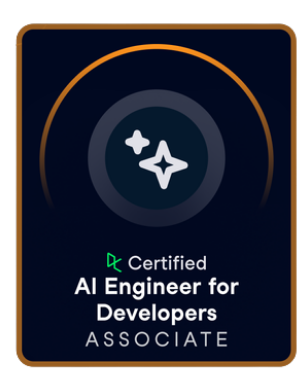

<h1 align="left">Hi, I'm Abigail!</h1>
<h4 align="left">A passionate developer creating solution‑driven and innovative tech experiences</h4>

  

  

# About Me
- BSITWMA student at FEU Institute of Technology
- Currently exploring LLM, and building AI-powered projects

## Contact  
For opportunities, projects, collaborations, you can reach me at:  
✉️ **agmnlo.by@gmail.com**

## Tech Stack
### Frontend

  

### Backend

  

## Tools

  

## Badges
### Core Skills

  
  
  

### Other Achievements

  
  
  
  
  

## Stats

